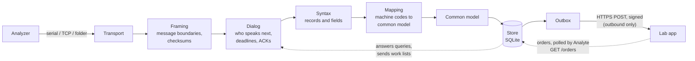
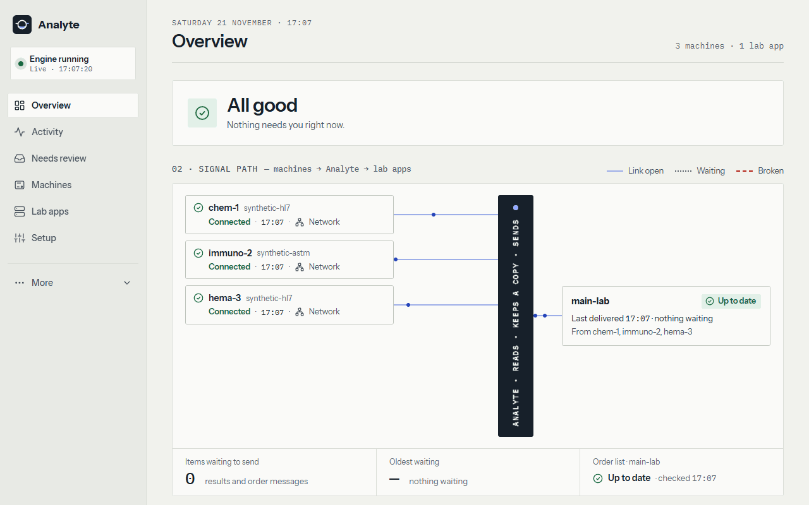
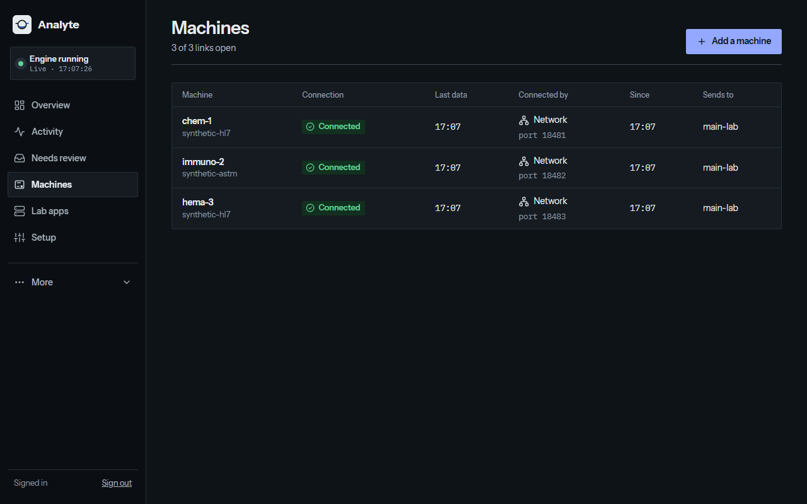
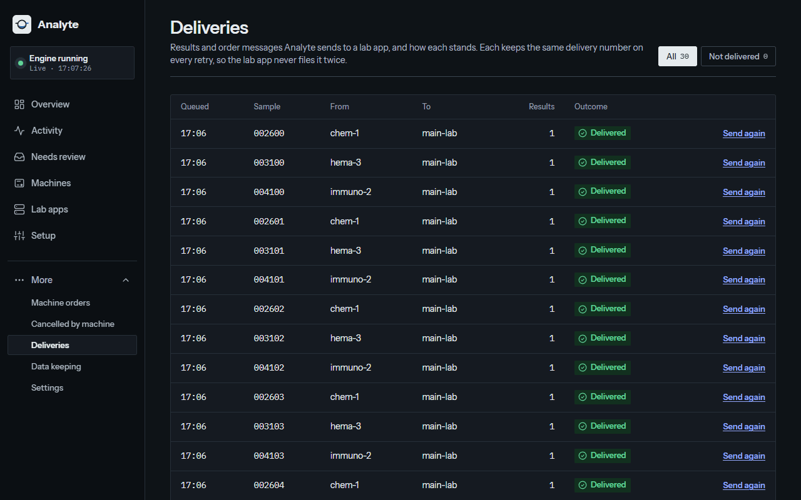
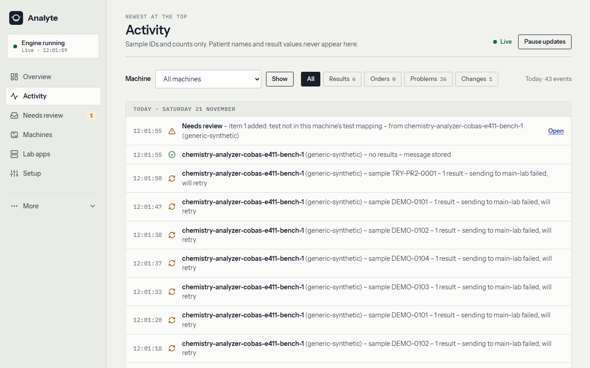
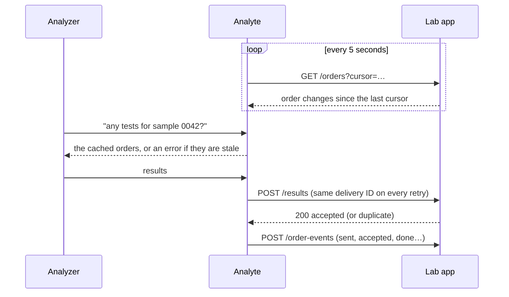

# Analyte

**Connect any lab analyzer to any lab app.**

Analyte runs on a PC in the lab, next to the analyzers. It talks to each
machine in that machine's own protocol, stores every message safely, and sends
the results to a lab app over HTTPS in one common format. It also takes work
orders from the lab app and hands them to the machines.

> **Status:** every protocol is built and tested from its official documents
> with synthetic data (*documented* level). No machine has been tested on real
> hardware yet; that comes with the first lab pilot ([the plan](docs/plan.md)).


*A result goes from a machine, through Analyte, to the lab app (synthetic data).*

## What Analyte is, and is not

| Analyte **is** | Analyte **is not** |
| --- | --- |
| A bridge: it receives, stores and delivers faithfully | A lab information system (LIS) |
| One program for many machines, each added with a config file | A rules engine: no auto-verification, reflex tests or QC decisions |
| Independent of any one lab app: it speaks a published contract | A clinical interpreter: it never judges a result |

Results end up in patient reports, so a few promises never bend
([ADR 0003](docs/adr/0003-clinical-safety-rules.md)):

- **Store before "got it".** A machine hears "got it" only once the data is
  safe on disk. If the disk fails or is nearly full, Analyte refuses visibly.
- **Never drop data.** What it cannot handle is parked for a person to review.
- **Keep the original.** Reprocessing adds a new version; it never overwrites.
- **Never invent.** No default sample IDs or guessed units; `<0.1` stays `<0.1`.
- **Never answer "no orders" when unsure.** If the lab app cannot be reached,
  the machine is told so, or told nothing.

## How it works

Every machine connection passes through the same layers. Each layer does one
job and can be replaced on its own ([ADR 0001](docs/adr/0001-rust-and-layered-architecture.md)).



The outbox sends each result with the same delivery ID on every retry, so the
lab app never files it twice. **Connections only go out**
([ADR 0004](docs/adr/0004-outbound-only-polled-orders.md)): Analyte posts
results and polls the lab app for orders, so the lab PC opens no inbound port.

## The two programs on Windows

- **The engine** (`analyte.exe`): a Windows service that does all the work,
  from boot. Its admin pages are on `127.0.0.1` only.
- **The Analyte app** (`analyte-app.exe`): a window and tray icon on the
  engine's pages, with notifications ([ADR 0019](docs/adr/0019-desktop-app.md)).
  People sign in with Windows ([ADR 0021](docs/adr/0021-windows-sign-in-pipe.md)).

IT can do everything the pages do from PowerShell too ([commands](docs/operations/commands.md)),
including setting up machines and lab apps with `analyte machines` and
`analyte lab-apps` through the Setup page's own checks
([from the command line](docs/operations/connect.md#from-the-command-line)).

The installer sets up both ([Windows packaging](packaging/windows/README.md)).
On Linux the engine is a systemd service ([Linux packaging](packaging/linux/README.md)).

## A look at it

Synthetic data only. The lab app is the [reference receiver](crates/testing/receiver/),
so results are delivered and the Overview is green.

| | |
| --- | --- |
|  |  |
| **Overview**: all good, and the path from machines to lab app | **Needs review**: parked items, with what to do next |
|  |  |
| **Machines** (dark): each connection and its last data | **Deliveries** (dark): every result delivered to the lab app |
|  |  |
| **Activity**: a live feed with sample IDs and counts only | **Setup**: add a machine and pick its lab app |

## Protocols

| Protocol family | Machines that use it | Evidence |
| --- | --- | --- |
| **ASTM** (CLSI LIS01-A2 + LIS02-A2) | Roche cobas e 411, BioCARE Biolyte 2000 | documented |
| **HL7 v2** (2.3.1 and 2.5.1) over **MLLP** | YHLO iFlash 1200, Boule Swelab Lumi | documented |
| **IHE LAW** (PaLM Rev 11.0) | none yet | documented ([Gazelle run](docs/conformance/gazelle/law-run/README.md)) |
| **POCT1-A** (CLSI POCT01-A2) | none yet | documented |
| **VIDAS PC Literal** (bioMérieux) | bioMérieux VIDAS | documented |
| **Autolyser** (Dialab) | Dialab Autolyser | documented |

**Evidence levels** ([ADR 0005](docs/adr/0005-evidence-levels.md)): *proven*
on the real machine, *simulated* against an official simulator or vendor
traces, *documented* from the documents only; never raised without proof. The
named machines are still blocked: their folders in [`machines/`](machines/README.md)
list what is missing. Scope and checklists: [docs/protocols](docs/protocols/README.md).

**How they were built:** each standard first, from its official documents
([ADR 0007](docs/adr/0007-standards-first.md)), then each machine as a config
file ([ADR 0002](docs/adr/0002-config-first.md)). Tests replay recorded
conversations ([ADR 0009](docs/adr/0009-recording-format.md)) and name the
source section of each rule; parsers also have property tests and
[fuzz targets](fuzz/README.md).

## Connecting a lab app

Any lab app can work with Analyte by implementing
[contract v1](docs/contract/v1.md) ([ADR 0008](docs/adr/0008-app-contract.md)).
Analyte always makes the call; the lab app only answers.



| Call | What it does |
| --- | --- |
| `GET /orders?cursor=…` | Analyte asks for order changes since its last cursor; the first call pages a full snapshot. Orders are trusted only after a complete page and for 30 seconds by default, so a machine never hears "no tests" from an out-of-date list ([building the cursor](docs/contract/orders-cursor.md)). |
| `POST /results` | One delivery of results with the original values, units and identities. The delivery ID stays the same on every retry; the app stores it first and answers a repeat as a duplicate. |
| `POST /order-events` | What happened to an order on the machine: sent, accepted, done, cancelled, rejected or uncertain. "Uncertain" never means "send it again". |

The app's answer tells Analyte what to do next: `200` done, `5xx`/`429` retry
(1 s up to 60 s, never giving up), `401`/`403` pause until the setup is fixed,
`400`/`409`/`422` park for review. Every call carries an API key, and each
POST is signed with [Standard Webhooks](https://www.standardwebhooks.com/).
Check your app with [`analyte-contract-check`](docs/contract/README.md#check-your-app),
or read the [reference receiver](crates/testing/receiver/), which does it all.

## Tech stack

- **Rust** 1.100.0 ([pinned](rust-toolchain.toml)), edition 2024, minimum 1.95.
  No `unsafe` code except three small Windows modules, each allowed by an ADR:
  access lists ([0017](docs/adr/0017-windows-access-list-unsafe.md)), the sign-in pipe
  ([0021](docs/adr/0021-windows-sign-in-pipe.md)) and the app's title bar ([0022](docs/adr/0022-title-bar-snap-layouts-and-window-menu.md)).
- **Tokio** for network and timers; **SQLite** (rusqlite) for the store.
- **axum + Askama**: server-rendered admin pages, no frontend framework
  ([ADR 0018](docs/adr/0018-server-rendered-pages-and-one-stylesheet.md)).
- **reqwest + rustls**, **serialport**, **quick-xml** for HTTPS, RS-232, POCT1-A.
- **Tauri 2 + WebView2** for the app; **Inno Setup 6** and **nfpm** to package.
- **proptest, cargo-fuzz, cargo-deny** for tests, fuzzing, licences, advisories.

## Getting started

You need the Rust toolchain ([rustup](https://rustup.rs/) installs the pinned
version). Python 3 and Bash are needed for the repository checks.

```sh
git clone https://github.com/vigani1/analyte.git
cd analyte
cargo build --workspace
cargo test --workspace --all-features
```

**Run the sample:** a synthetic HL7 machine on `127.0.0.1:5600` whose demo
lab app does not exist, so results are kept and retried. Any synthetic keys
work; the signing key is `whsec_` plus base64 of 32 random bytes:

```sh
cargo run -p analyte -- check-config crates/analyte/examples/analyte.toml
export ANALYTE_SECRET_DEMO_API=any-test-key
export ANALYTE_SECRET_DEMO_SIGNING="whsec_$(head -c 32 /dev/urandom | base64)"
cargo run -p analyte -- run crates/analyte/examples/analyte.toml
```

Delete `crates/analyte/data/` afterwards. For admin pages add an `[admin]`
section ([program guide](crates/analyte/DETAILS.md)). To install on a lab PC,
see the [operations guides](docs/operations/README.md).

## Contributing

Contributions are welcome. Start with [CONTRIBUTING.md](CONTRIBUTING.md) and
[AGENTS.md](AGENTS.md); the rules apply to people and coding assistants alike.

- Before sending a change, run the checks in [Verification](AGENTS.md#verification).
- Add a machine with [adding a machine](docs/adding-a-machine.md), or a
  vendor protocol with [adding a vendor protocol](docs/adding-a-vendor-protocol.md).
- Only synthetic or de-identified data; never standards or vendor manuals.
- Sign off every commit (`git commit -s`, the
  [Developer Certificate of Origin](https://developercertificate.org/)).

Find your way around: [the crates](crates/README.md) (engine, app, layers,
protocols, core, testing), [the decisions](docs/adr/README.md),
[the glossary](docs/glossary.md) and [test quality](docs/testing/quality.md).

## Licence

Analyte is licensed under the [Apache License 2.0](LICENSE).
