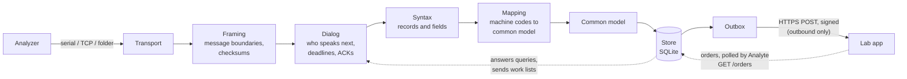
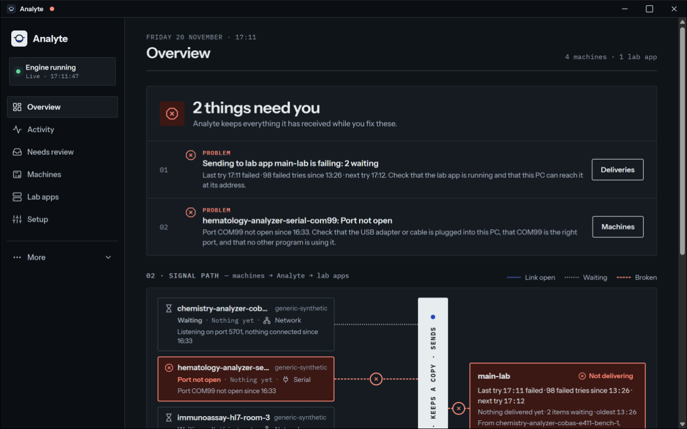
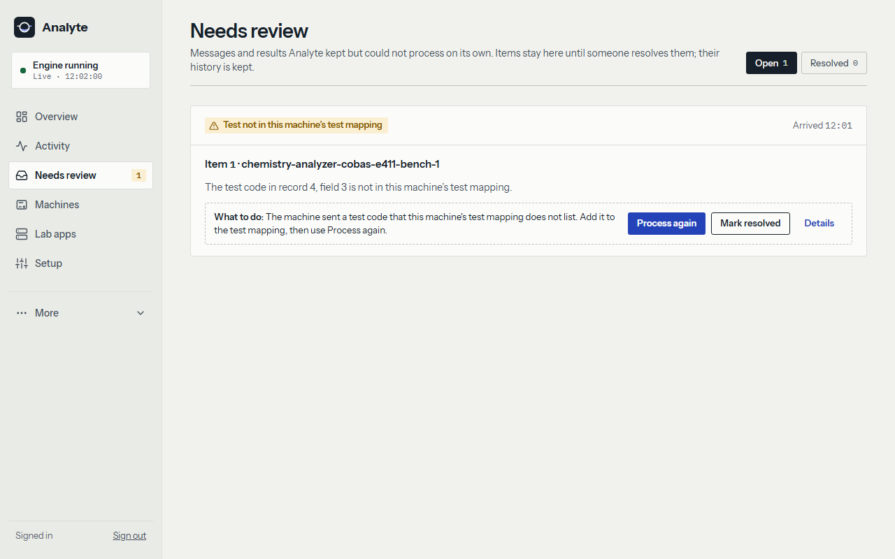
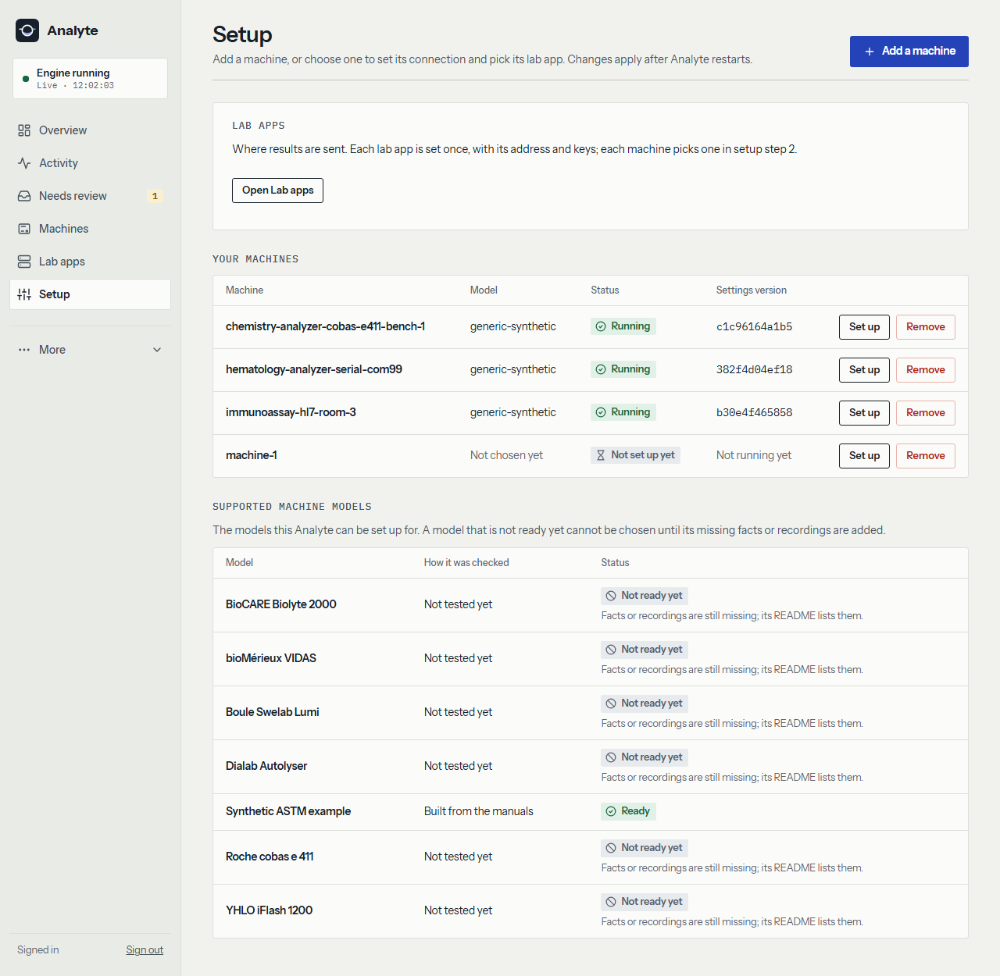

# Analyte

**Connect any lab analyzer to any lab app.**

Analyte is a small program that runs on a PC in the lab, next to the
analyzers. It talks to each machine in that machine's own protocol, stores
every message safely, and passes results to a lab app over HTTPS in one common
format. It also takes work orders from the lab app and hands them to the
machines that ask for them or need them sent ahead.

> **Status:** every supported protocol is built and tested at the
> *documented* level: from the official documents, with synthetic tests. No
> machine has been qualified on real hardware yet. That comes with the first
> lab pilot. See [the plan](docs/plan.md) for details.

## What Analyte is, and is not

| Analyte **is** | Analyte **is not** |
| --- | --- |
| A bridge: it receives, stores and delivers faithfully | A lab information system (LIS) |
| One program for many machines, added with a config file | A rules engine: no auto-verification, reflex tests or QC decisions |
| Independent of any one lab app: it speaks a published contract | A clinical interpreter: it never judges a result |

Results it moves end up in patient reports, so it keeps a few promises that
never bend ([ADR 0003](docs/adr/0003-clinical-safety-rules.md)):

- **Store before acknowledging.** A machine hears "got it" only after the
  data is safely on disk. If the disk is failing or nearly full, Analyte
  refuses visibly.
- **Never drop data.** Anything it cannot handle is parked with a reason for a
  person to review. It is never deleted.
- **Keep the original.** The exact bytes are kept, with the driver and config
  version that read them. Reprocessing adds a new version and never
  overwrites.
- **Never invent.** No default sample IDs, no guessed units, values kept as
  written (`<0.1` stays `<0.1`), and sample IDs keep their leading zeros.
- **Never answer "no orders" on a failed lookup.** If the lab app cannot be
  reached, a machine is told so, or told nothing. It never hears "no tests".

## How it works

Each machine connection passes through the same layers. Each layer does one
job and can be replaced on its own ([ADR 0001](docs/adr/0001-rust-and-layered-architecture.md)).



- **Transport** moves bytes over a serial cable, a TCP connection or a watched
  folder.
- **Framing** finds where each message starts and ends and checks checksums.
- **Dialog** is a state machine per connection. It knows who speaks next and
  when time is up. It acknowledges only after the store says the data is
  durable.
- **Syntax** reads and writes the protocol's records. **Mapping** turns
  machine codes into the common model, using only what the machine's config
  says.
- **Store, outbox and orders.** The store keeps everything. The outbox
  delivers each result with the same delivery ID on every retry. Orders from
  the lab app are cached and used to answer the machines.

**Connections only go out** ([ADR 0004](docs/adr/0004-outbound-only-polled-orders.md)).
The lab PC never opens an inbound internet port. Analyte posts results to the
lab app and *polls* it for order changes. Analyzer connections stay on the
lab network.

## The two programs on Windows

| | Engine: `analyte.exe` | Analyte app: `analyte-app.exe` |
| --- | --- | --- |
| What it is | A Windows service that does all the work | A desktop window and a tray icon ([ADR 0019](docs/adr/0019-desktop-app.md)) |
| When it runs | In the background, from boot, with nobody signed in | When someone signs in to Windows, if they chose it |
| What it shows | Its admin pages, on `127.0.0.1` only | The engine's pages under its own title bar; the engine's state in the tray, with notifications when things get worse |
| Sign-in | Admin key; Windows accounts through a local pipe | Signs people in with their Windows account ([ADR 0021](docs/adr/0021-windows-sign-in-pipe.md)), so the audit names them |
| Never | Interprets results | Runs the engine, holds the admin key or shows another site |

**Installing.** The [Inno Setup](https://jrsoftware.org/isinfo.php)
installer places both programs and registers the engine as the service
`Analyte`, with automatic start and restart on failure. It creates the
`Analyte users` group and shows the new admin key once. The same work can be
done by hand with the PowerShell scripts in
[`packaging/windows/`](packaging/windows/README.md): `install.ps1`,
`stop.ps1` and `uninstall.ps1`. Start the service with `Start-Service Analyte`
or the app's **Start engine** button. Uninstalling keeps data, configuration
and backups.

The admin pages also work in any browser at `http://127.0.0.1:<admin port>/`
with the admin key. **Linux** runs the engine only, as a systemd service from
the `.deb` or `.rpm` package ([packaging/linux](packaging/linux/README.md));
there you use a browser.

## A look at it

All data in these pictures is synthetic. The demo lab app's address is
unreachable on purpose, so the screens show results being kept and retried.

| | |
| --- | --- |
|  |  |
| **The Analyte app** (dark): the engine's Overview in its own window | **Overview**: what needs you, and the path from machines to lab app |
|  |  |
| **Needs review**: parked items, with what to do next | **Machines** (dark): each connection, its last data and its lab app |
|  |  |
| **Activity**: a live feed with sample IDs and counts only, never patient names or values | **Setup**: add a machine in four steps and pick its lab app |

The pages are rendered on the server, follow the system's light or dark
setting, and never show patient names or result values.

## Protocols

| Protocol family | Analyte's pieces (framing · dialog · syntax · mapping) | Machines that use it | Evidence |
| --- | --- | --- | --- |
| **ASTM**: CLSI LIS01-A2 (formerly ASTM E1381) + LIS02-A2 (formerly E1394) | `framing::astm` · `dialog::astm` · `analyte-astm` · `mapping::astm` | Roche cobas e 411, BioCARE Biolyte 2000 (both blocked); the synthetic ASTM example | documented |
| **HL7 v2** (2.3.1 and 2.5.1) over **MLLP** | `framing::hl7` (MLLP) · `dialog::hl7` · `analyte-hl7` · `mapping::hl7` | YHLO iFlash 1200, Boule Swelab Lumi (both blocked) | documented |
| **IHE LAW** (PaLM Rev 11.0), as Analyzer Manager | MLLP · `dialog::law` · `analyte-hl7` (`law`) · `mapping::law` | None yet | documented: Gazelle's validator passes all 8 messages Analyte sends; the simulator run did not reach *simulated* ([why](docs/conformance/gazelle/law-run/README.md)) |
| **POCT1-A** (CLSI POCT01-A2), as Observation Reviewer | `framing::poct` · `dialog::poct` · `analyte-poct` (XML) · `mapping::poct` | None yet | documented |
| **VIDAS PC Literal** (bioMérieux vendor format) | `framing::vidas` · `dialog::vidas` · `analyte-vidas` · `mapping::vidas` | bioMérieux VIDAS (blocked) | documented |
| **Autolyser** (Dialab vendor format) | `framing::autolyser` · `dialog::autolyser` · `analyte-autolyser` · `mapping::autolyser` | Dialab Autolyser (blocked) | documented |

**Evidence levels** ([ADR 0005](docs/adr/0005-evidence-levels.md)) say how far
each piece has been proven, and are never raised without proof:

- **proven:** tested against the real machine, with recorded conversations;
- **simulated:** tested against an official simulator or vendor sample traces;
- **documented:** built from the documents only.

"Blocked" means the machine's folder in [`machines/`](machines/README.md)
lists the settings or recordings still missing, and nothing is guessed in the
meantime. The setup page shows these models as *Not ready yet*. Each protocol's
scope, decisions and checklist are in [docs/protocols](docs/protocols/README.md).

### How they were built

- **Standards first** ([ADR 0007](docs/adr/0007-standards-first.md)): each
  standard is implemented from its official documents and tested on its own,
  before any machine. A machine's quirks go in its config, never in the
  standard's code.
- **Config first** ([ADR 0002](docs/adr/0002-config-first.md)): a machine that
  speaks a supported protocol is a config file, not new code.
- **Recorded conversations** ([ADR 0009](docs/adr/0009-recording-format.md)):
  bytes, direction and timing are the main test fixtures, replayed byte for
  byte by a simulated machine.
- **Property tests and fuzzing:** framers and parsers have property tests,
  and the byte readers have fuzz targets that CI runs on Linux
  ([fuzz](fuzz/README.md)).
- **Traceable rules:** every protocol rule's test has a short behaviour name
  and a comment naming its source section, for example `// HL7 2.5.1 §2.7`.
  A CI script checks that every test named in a checklist exists.

## Connecting a lab app

Any lab app, in any language, can receive from Analyte by implementing
[contract v1](docs/contract/v1.md) ([ADR 0008](docs/adr/0008-app-contract.md)):

| Endpoint | Direction | What it carries |
| --- | --- | --- |
| `POST /results` | Analyte → app | One result delivery |
| `POST /order-events` | Analyte → app | What happened to an order on the machine (sent, accepted, done, uncertain…) |
| `GET /orders?cursor=…` | Analyte asks the app | Order changes since the last cursor ([how to build it](docs/contract/orders-cursor.md)) |

- Every request carries a bearer API key. Each POST is signed with
  [Standard Webhooks](https://www.standardwebhooks.com/) (HMAC-SHA256), with
  key rotation.
- Each delivery has a **delivery ID that stays the same on every retry**. The
  app stores it with its effects before answering, and answers a repeat as a
  duplicate.
- The app's answer tells Analyte what to do next: done, retry later, fix the
  setup, or park for review.

Two tools help you check an integration:

- **[`analyte-contract-check`](docs/contract/README.md#check-your-app)** runs
  the published test vectors, including invalid cases, against your app's
  real endpoints and prints PASS, FAIL or SKIP for each.
- **The reference receiver** ([`crates/testing/receiver`](crates/testing/receiver/))
  is a small app that implements the whole contract. Analyte's own tests run
  against it, and it is a worked example to read.

## Tech stack

Versions come from the workspace [`Cargo.toml`](Cargo.toml) and
[`rust-toolchain.toml`](rust-toolchain.toml).

| Part | Uses | For |
| --- | --- | --- |
| Language | Rust 1.100.0 (pinned), edition 2024; minimum supported 1.95 | Everything; no `unsafe` code except two small Windows modules allowed by ADRs [0017](docs/adr/0017-windows-access-list-unsafe.md) and [0021](docs/adr/0021-windows-sign-in-pipe.md) |
| Async runtime | Tokio | Network, timers and coordination; serial I/O and storage run on their own threads |
| Admin pages | axum + Askama | Server-rendered HTML, one stylesheet and one small live-update script; no frontend framework; CSP `default-src 'self'` ([ADR 0018](docs/adr/0018-server-rendered-pages-and-one-stylesheet.md)) |
| Store | SQLite via rusqlite (bundled) | Raw messages, results and revisions, the outbox, orders and the audit |
| Outbound HTTPS | reqwest with rustls; hmac + sha2 | Delivering results, polling orders, signing requests |
| Serial ports | serialport | RS-232 and USB serial adapters |
| POCT XML | quick-xml | Reading POCT1-A messages, never resolving external entities |
| Desktop app | Tauri 2 + WebView2 | The Windows window and tray |
| Installer | Inno Setup 6 + Windows PowerShell 5.1 | Installing the service and the app |
| Linux packages | nfpm | `.deb` and `.rpm` with a systemd unit |
| Checks | proptest, cargo-fuzz, cargo-deny | Property tests, fuzzing, and license and advisory checks |

## Repository map

Crates are grouped by kind, and every crate of a kind has the same layout
([ADR 0012](docs/adr/0012-uniform-layout-and-naming.md)). The full map, with
one line per crate, is in [crates/README.md](crates/README.md).

| Kind | Crates | Job |
| --- | --- | --- |
| program | [`analyte`](crates/analyte/), [`app`](crates/app/) | The engine; the Windows desktop app |
| steps | [`transport`](crates/steps/transport/), [`framing`](crates/steps/framing/), [`dialog`](crates/steps/dialog/), [`mapping`](crates/steps/mapping/), [`sink`](crates/steps/sink/) | The layers every protocol passes through; `sink` delivers to lab apps |
| protocols | [`astm`](crates/protocols/astm/), [`hl7`](crates/protocols/hl7/), [`poct`](crates/protocols/poct/), [`vidas`](crates/protocols/vidas/), [`autolyser`](crates/protocols/autolyser/) | The syntax of each protocol family (LAW lives in `hl7`) |
| core | [`model`](crates/core/model/), [`store`](crates/core/store/), [`config`](crates/core/config/), [`contract`](crates/core/contract/) | The common model, durable storage, config loading, and the lab-app contract |
| testing | [`receiver`](crates/testing/receiver/), [`contract-check`](crates/testing/contract-check/), [`sim`](crates/testing/sim/), [`fixtures`](crates/testing/fixtures/) | The reference receiver, the contract checker, recorded-conversation replay, and shared synthetic data |

Elsewhere: [`machines/`](machines/README.md) holds machine definitions,
[`docs/`](docs/) holds the plan, ADRs, protocol notes, contract and guides,
and [`packaging/`](packaging/) holds the installers.

## Getting started

You need the Rust toolchain ([rustup](https://rustup.rs/) installs the pinned
version on first use). Python 3 and Bash are needed for the repository checks.

```sh
git clone https://github.com/vigani1/analyte.git
cd analyte
cargo build --workspace
cargo test --workspace --all-features
```

Before sending a change, run the full set of checks listed under
[Verification in AGENTS.md](AGENTS.md#verification):

```sh
cargo fmt --check
cargo clippy --all-targets --all-features -- -D warnings
cargo test --workspace --all-features
cargo deny check
cargo check --manifest-path fuzz/Cargo.toml --bins
cargo clippy -p analyte -p analyte-sink --all-targets --no-default-features -- -D warnings
cargo test -p analyte -p analyte-sink --no-default-features
bash scripts/check-layout.sh
```

**Run the engine with the sample config.** It is a synthetic HL7 machine
listening on `127.0.0.1:5600`, delivering to a demo lab app that does not
exist. Results are kept and retried. The two key variables can hold any
synthetic values, and the signing key is `whsec_` plus base64 of 32 random
bytes:

```sh
cargo run -p analyte -- check-config crates/analyte/examples/analyte.toml
export ANALYTE_SECRET_DEMO_API=any-test-key
export ANALYTE_SECRET_DEMO_SIGNING="whsec_$(head -c 32 /dev/urandom | base64)"
cargo run -p analyte -- run crates/analyte/examples/analyte.toml
```

The sample keeps its store in `crates/analyte/data/`; delete that folder
afterwards. It has no admin pages: add an `[admin]` section to try them
([program guide](crates/analyte/DETAILS.md)).

**Install on a lab PC:** follow [Install](docs/operations/install.md), then
[Connect](docs/operations/connect.md) a machine. Daily use and recovery are in
the [operations guides](docs/operations/README.md).

## Contributing

Contributions are welcome. Start with [CONTRIBUTING.md](CONTRIBUTING.md) and
the rules in [AGENTS.md](AGENTS.md), which apply to people and coding
assistants alike.

- **Add a machine:** [adding a machine](docs/adding-a-machine.md). Usually a
  config file, its README and recordings.
- **Add a vendor protocol:** [adding a vendor protocol](docs/adding-a-vendor-protocol.md),
  which shows where each piece lives.
- **State the evidence level** of every driver and machine config, and never
  raise it without the evidence: a real-machine recording, a simulator run or
  vendor traces.
- **Only synthetic or de-identified data.** Never commit patient data,
  standards documents or vendor manuals, or text copied from them.
- **Sign off every commit** (`git commit -s`) under the
  [Developer Certificate of Origin](https://developercertificate.org/).

Background: [the plan](docs/plan.md), [the decisions (ADRs)](docs/adr/README.md),
[the glossary](docs/glossary.md) and [test quality](docs/testing/quality.md).

## Licence

Analyte is licensed under the [Apache License 2.0](LICENSE).
